# Preset gallery

Every built-in look, drawn by the widget's own code with a sample song and a made-up spectrum. Apply one in
**Settings, Visualizer, Presets**. Made by `tools/gallery/render.sh`.

## Visualizer looks

### Classic bars

Plain bars, nothing else.

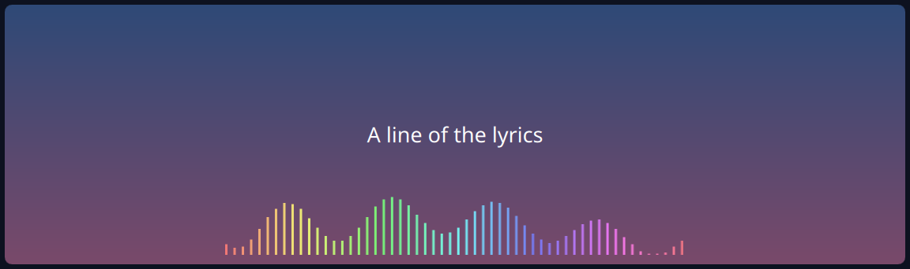

### Soft wave

A smooth wave with a soft glow, in the Lagoon palette.

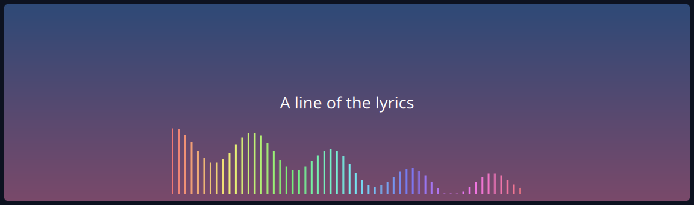

### Neon mountain

A glowing ridge that follows the music, in orchid colors.

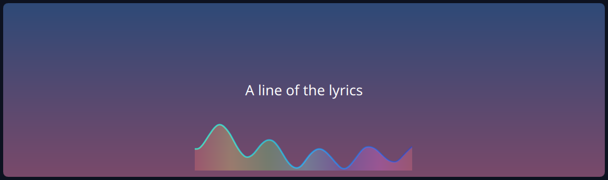

### LED rack

A stereo-rack meter: green to red segments with caps that hang on.

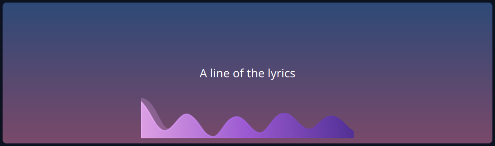

### Dot matrix

A grid of lit pixels, in warm Cinder colors.

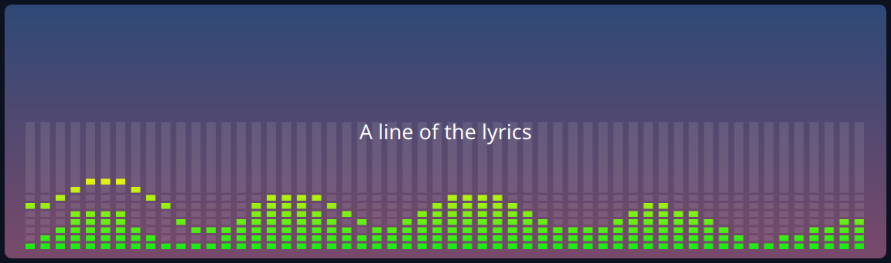

### Orb pulse

An orb that breathes with the bass; the lyrics swell a little on the beat.

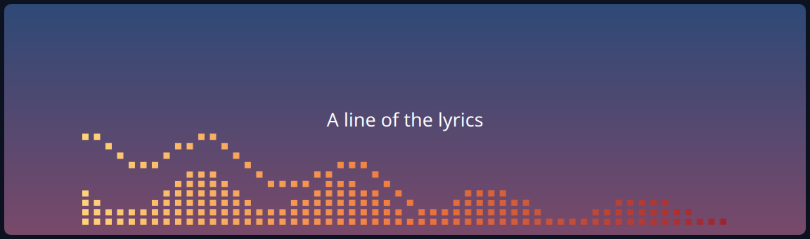

### Radial rainbow

A turning ring of spokes in a slowly moving rainbow.

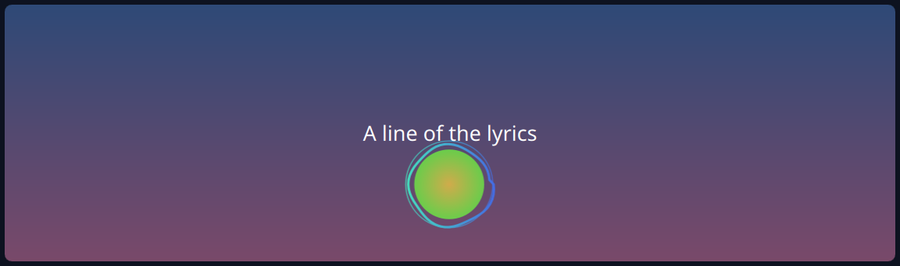

### Green scope

An oscilloscope trace with a green glow.

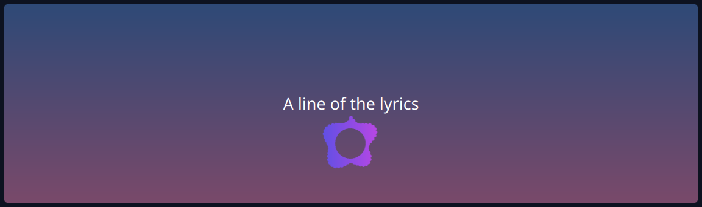

### Silk ribbon

A flowing ribbon in sunset colors.

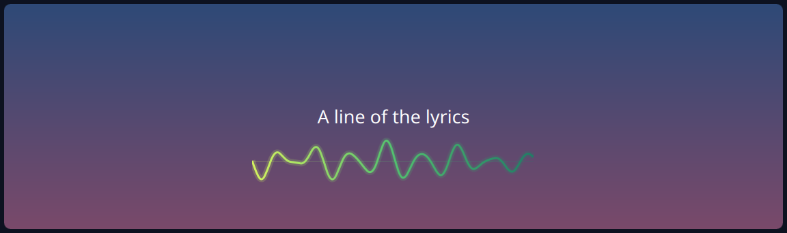

### Spark storm

Sparks bounce on every beat; the edges glow with the bass.

### Calm

A slow, muted wave with reduced motion: easy on the eyes.

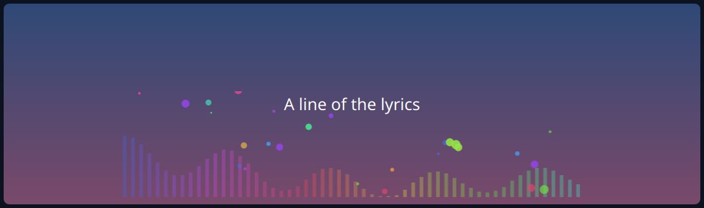

### Battery friendly

Bars at 20 frames a second, no glow, no motion effects.

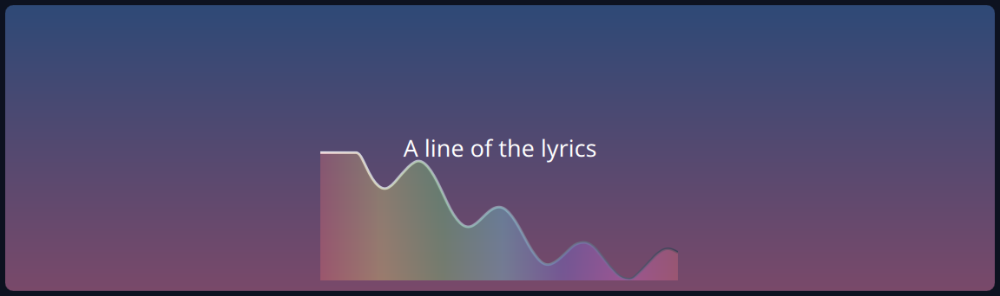

### Neon terrain

A skyline of peaks over a grid that rolls towards you (GPU).

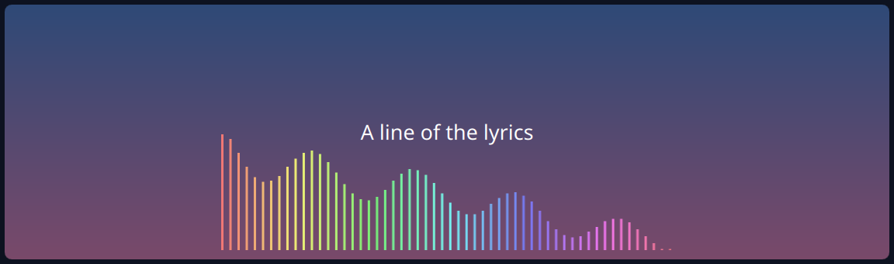

### Tunnel run

Rings and spokes rushing past, in rainbow colors (GPU).

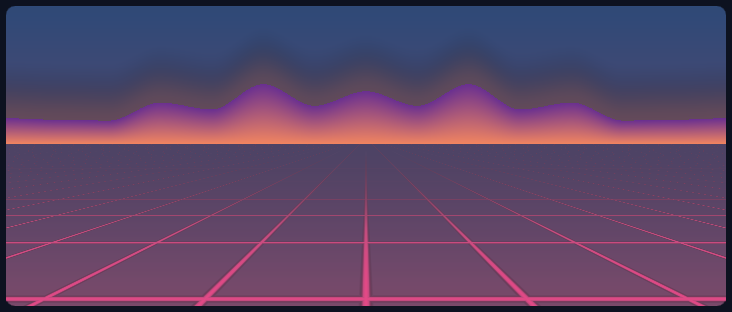

### Plasma wash

A warm liquid field that swells with the bass (GPU).

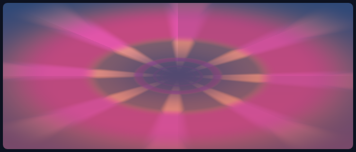

### Stereo scope

Left against right: the stereo image as a glowing figure.

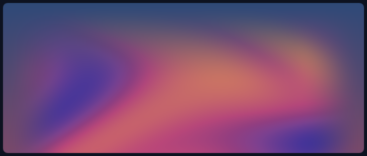

## Cards, posters, orbits and strips

### Plain card

Cover, text, buttons and a sleek seek bar on a dark card.

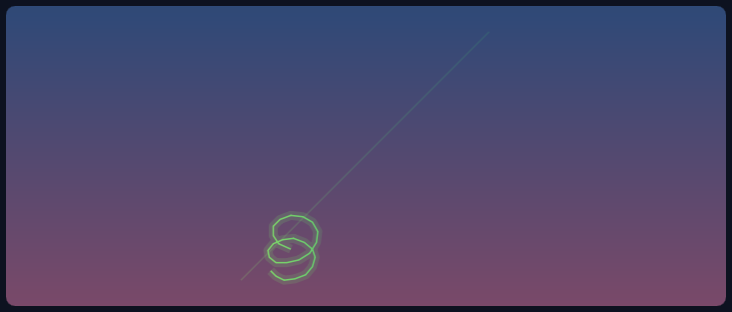

### Frosted card

The same layout on a frosted-glass card with a soft shadow.

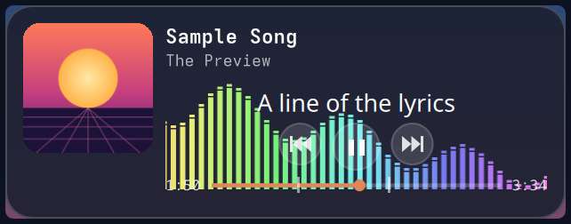

### Cover wash

The cover blurred behind the card, a round cover with a glow.

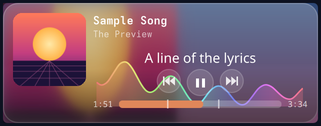

### Midnight neon

A near-black card with a neon mountain and a pulsing seek bar.

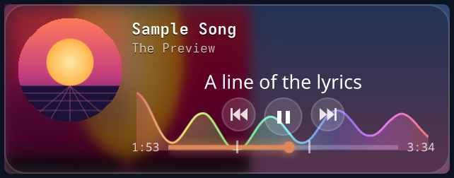

### Turntable

A spinning record on an atmosphere of the cover's colors.

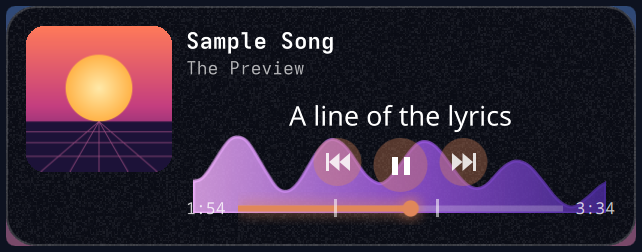

### Disc player

A CD with a squiggle seek bar over the blurred cover.

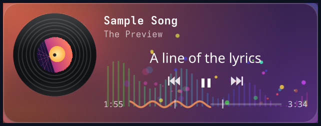

### Arcade

A sharp pixel cover, an LED meter and a time-only readout.

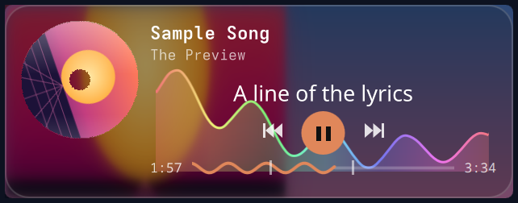

### Glass lens

Clear glass: the cover seen through a lens that follows the pointer.

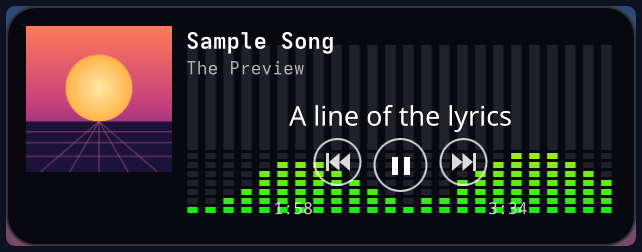

### Quiet glass

A calm frosted card with a mirrored wave and one round play button.

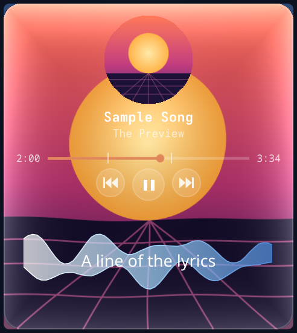

### Album mist

The cover's colors bleed in from the corners; a ribbon below.

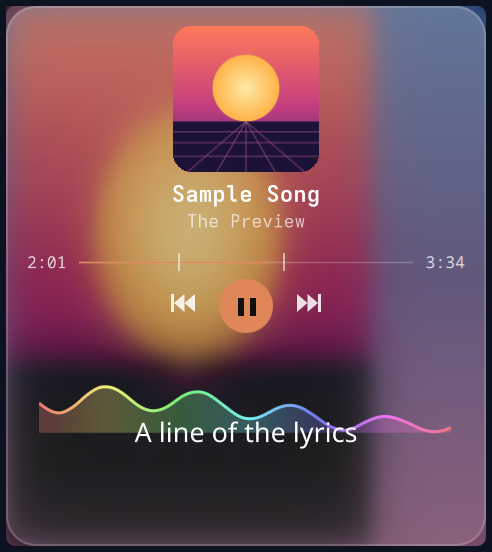

### Lyrics card

The song's lyric line under the artist, with a ribbon.

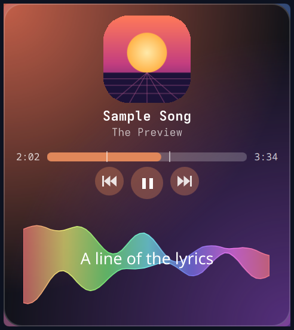

### Poster

The title set big, the music as a soft texture behind it, and a clock.

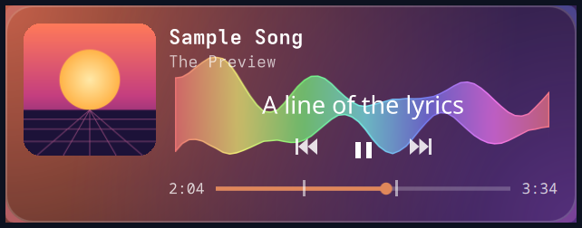

### Hanging bars

A centered title with bars hanging from the top edge.

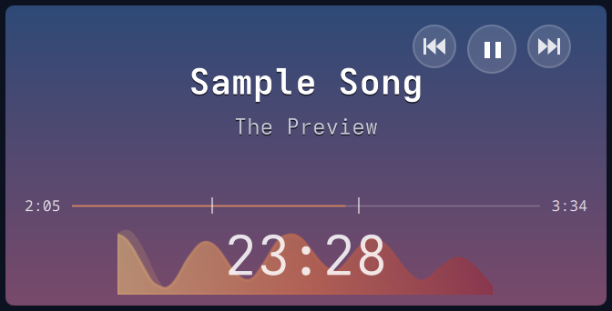

### Stalactites

Peak bars drip from the top edge towards the title, in icy colors.

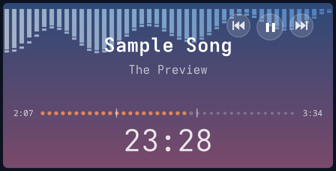

### Hero stage

The visualizer takes the stage; the track text tucks underneath.

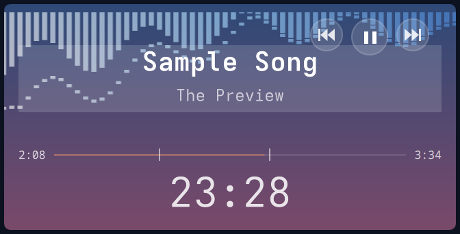

### Orbit

The cover is the center; bars circle it and the cover breathes with the bass.

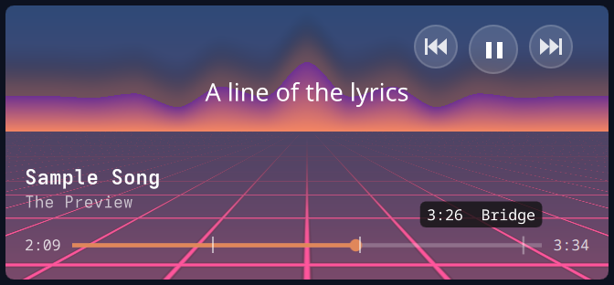

### Halo

A spinning record inside a ring of bars, with a progress ring.

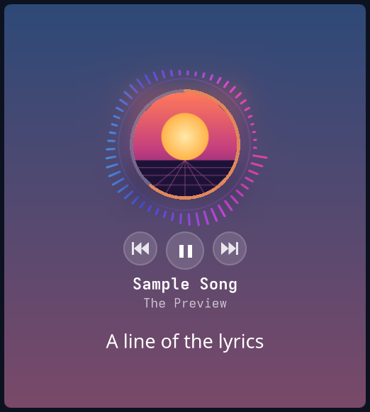

### Slim strip

A wide, low bar for the bottom of the screen.

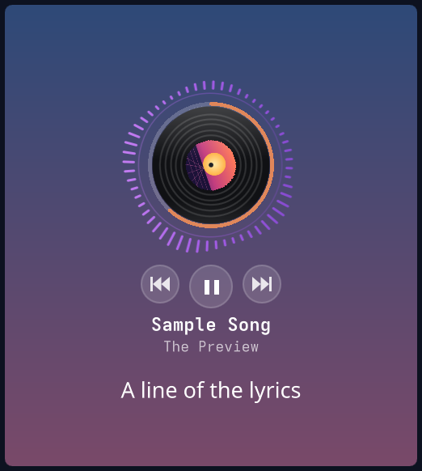

### Mirrored minimal

Cover on the right, dotted progress, no card, buttons on hover.

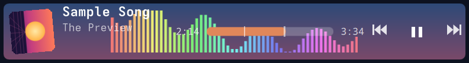

### Compact

No cover column: visualizer, seek bar and title only.

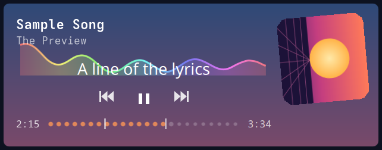
